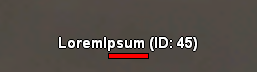

# IDNameTag

[English](README.md) | **Português**

Plugin `.asi` para **SA-MP** que muda o nametag dos jogadores de `Nome (45)` para `Nome (ID: 45)`. O formato pode ser configurado.

# Preview:



## Instalação

1. Baixe o `IDNameTag.asi` na aba [Releases](../../releases).
2. Coloque o arquivo na pasta do GTA San Andreas, ao lado do `gta_sa.exe`.
3. Você precisa de um **ASI Loader**. Ele já vem no CLEO, no SilentPatch e no SAMPFUNCS.

O `IDNameTag.ini` é criado sozinho na primeira vez que o jogo abre.

## Configuração (`IDNameTag.ini`)

```ini
[NameTag]
Format=%s (ID: %d)
Disable_ID=0
```

`%s` é o **nome** do jogador e `%d` é o **ID**.

Use `Disable_ID=1` para esconder o ID e mostrar só o nome (`LoremIpsum`). Com essa opção ligada, o `Format` é ignorado.

| `Format=`     | Resultado               |
|---------------|-------------------------|
| `%s (ID: %d)` | `LoremIpsum (ID: 45)` |
| `%s [%d]`     | `LoremIpsum [45]`     |
| `%s #%d`      | `LoremIpsum #45`      |

Regras:

- O `%s` precisa vir **antes** do `%d`, e cada um aparece uma vez só.
- O formato pode ter no máximo **24 caracteres**.
- Use `%%` para escrever um `%` literal.
- Se o formato for inválido, o plugin usa o padrão `%s (ID: %d)`. Isso evita que o jogo trave.

O `.ini` é lido só quando o jogo abre.

## Como funciona

O `samp.dll` monta o texto do nametag com `sprintf(buf, "%s (%d)", nome, id)`. O plugin procura essa string na memória do `samp.dll`. Depois troca as instruções `push` que apontam para ela por um ponteiro para o formato configurado.

Como não usa endereços fixos, o plugin deve funcionar em várias versões do cliente (0.3.7 R1/R3/R4/R5, 0.3.DL). Para ver o diagnóstico, use o [DebugView](https://learn.microsoft.com/sysinternals/downloads/debugview). Ele mostra se a string foi encontrada e quantas referências foram alteradas.

> Algumas proteções anticheat de servidores verificam alterações no `samp.dll`. A mudança é só visual, mas confira as regras do servidor antes de usar.

## Compilando

Requisitos: Visual Studio com a carga de trabalho **"Desenvolvimento para desktop com C++"**.

```bat
build.bat
```
O arquivo gerado fica em `out\IDNameTag.asi`. Ele é sempre compilado em 32 bits


## Autor:

**[Shazanxz](https://github.com/Shazanxz)**

## Licença

[MIT](LICENSE)
